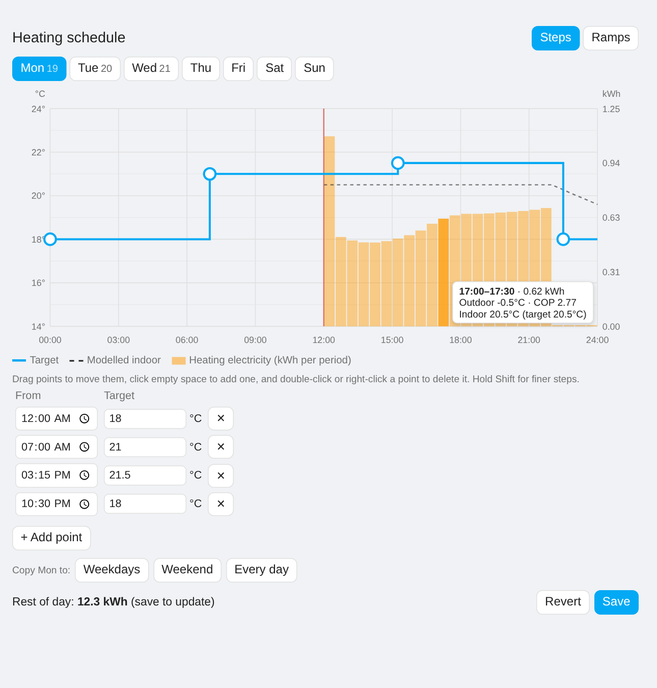
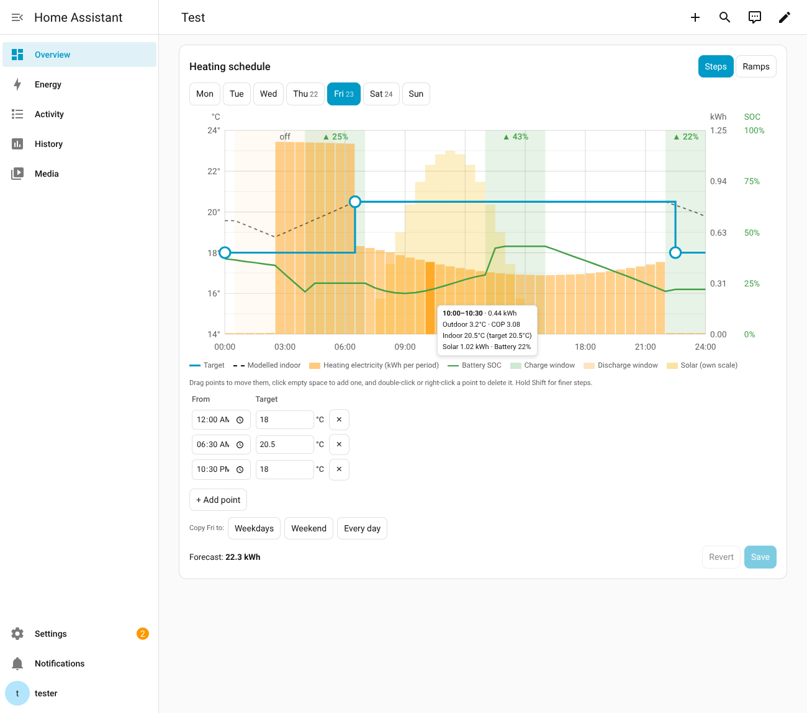

# Heat Load Predictor

[](https://hacs.xyz/docs/faq/custom_repositories)
[](https://github.com/rszemeti/HeatingPredictor/actions/workflows/validate.yml)
[](https://github.com/rszemeti/HeatingPredictor/actions/workflows/tests.yml)

A Home Assistant integration that forecasts how much **electricity your heat pump will use** in each period (30 minutes by default) over the next one to two days. Use it to decide how much to charge a home battery on a cheap overnight tariff, to plan around time-of-use prices, or just to see what tomorrow's heating will cost.

It works from:

- your **weather forecast** (any `weather` entity with an hourly forecast)
- a **daily target temperature curve**, which you draw on a dashboard card
- your heat pump's **COP curve** and **maximum heat output**
- your house's **heat loss**, **thermal capacity** and **internal gains**

The house is modelled as a single thermal mass rather than a fixed load per degree. Setbacks therefore show up as coasting down and then recovering. With **pre-heat** on, heating starts early enough to reach each step up in your schedule on time, so the heavy periods fall where the heat pump will actually run.



## Installation

### HACS (recommended)

1. In Home Assistant, open **HACS → ⋮ → Custom repositories**.
2. Add `https://github.com/rszemeti/HeatingPredictor` with the type **Integration**.
3. Find **Heat Load Predictor** in HACS, download it, and restart Home Assistant.

### Manual

Copy `custom_components/heat_load_predictor` into your `config/custom_components/` folder, then restart Home Assistant.

### Set up

Go to **Settings → Devices & services → Add integration → Heat Load Predictor**. Choose your weather entity and, optionally, an indoor temperature sensor. The other defaults describe a typical house with an 8 kW heat pump. You'll get much better forecasts once you replace them with your own figures, as explained below.

## The schedule card

The card is served by the integration and loads automatically, so you don't need to add a dashboard resource. Add it to a dashboard:

```yaml
type: custom:heat-load-schedule-card
title: Heating schedule
# entry_id: ...        # only needed if you set up more than one predictor
# time_step: 15        # minutes; dragging snaps to this (hold Shift for 5)
# temp_step: 0.5       # °C; dragging snaps to this (hold Shift for 0.1)
# y_min: 14            # temperature axis range (it widens to fit your points)
# y_max: 24
# show_battery: true  # battery windows and projected SOC (needs the battery planner)
# show_solar: true    # solar forecast bars, on their own scale
```

- **Edit points:** drag a point to move it, click empty space to add one, and double-click (or right-click) a point to delete it. The table under the chart gives exact times and temperatures.
- **Other days:** each day of the week has its own curve. The tabs run from today through the next six days. Pick a day with the tabs, then use **Copy to** to apply it to weekdays, the weekend or every day.
- **Curve shape:** **Steps** holds each temperature until the next point, and **Ramps** slopes between points.
- **Save:** saving reruns the forecast straight away. Saving needs an admin user.
- **Download planning data:** with the battery planner on, this saves a JSON file of everything the planner used for its last plan (forecasts, solar slots, battery level, settings, cheap windows) and what it decided. Useful for reporting a plan that looks wrong.
- **Reading the chart:** the bars show forecast electricity per period, and the dashed line shows the modelled indoor temperature. Hovering a bar shows the outdoor temperature, the COP, and any shortfall when the heat pump can't keep up. With the battery planner on, the chart also shows the charge and discharge windows, the projected SOC, and a strip under the chart with the planned storage mode: blue for Feed-in priority (export first), grey for Self-Use. Hover the strip for the times.

## Sensors

| Entity | Meaning |
|---|---|
| `…_heating_electricity_this_period` | kWh for the current period. Its `forecast` attribute lists every period with `start`, `kwh`, `heat_kwh`, `t_out`, `t_in`, `t_target`, `cop` and `shortfall_k`. |
| `…_heating_electricity_next_24h` | kWh over the next 24 hours |
| `…_heating_electricity_rest_of_today` | kWh from now until midnight |
| `…_heating_electricity_tomorrow` | kWh for tomorrow. Its `complete` attribute is `false` if the weather forecast doesn't reach the end of the day. |
| `…_heating_peak_power_next_24h` | Highest average electrical draw in any period over the next 24 hours, in kW |

The `forecast` attribute is kept out of the recorder database because it's large.

## Services

`heat_load_predictor.get_forecast` returns the per-period forecast and the totals as a service response. Set `refresh: true` to rerun the model first.

```yaml
action: heat_load_predictor.get_forecast
response_variable: heat
# heat.periods → [{start, kwh, heat_kwh, t_out, t_in, t_target, cop, shortfall_k}, ...]
```

`heat_load_predictor.set_schedule` replaces the schedule, for example to switch to a holiday profile from an automation:

```yaml
action: heat_load_predictor.set_schedule
data:
  schedule:
    interpolation: step        # or linear
    days:
      mon: [{time: "00:00", temp: 18}, {time: "06:30", temp: 20.5}, {time: "22:30", temp: 18}]
      # ... tue to sun, every day needs at least one point
```

### Example: battery charge needed for tomorrow's heating

```yaml
template:
  - sensor:
      - name: "Battery charge for heating"
        unit_of_measurement: kWh
        state: >
          {{ (states('sensor.heat_pump_heating_electricity_tomorrow') | float(0) * 1.1) | round(1) }}
```

The 1.1 allows for about 10% battery round-trip loss. For a period-by-period plan, read the `forecast` attribute or call `get_forecast`.

## Getting your numbers right

All of these can be changed later under **Settings → Devices & services → Heat Load Predictor → Configure**.

### Heat loss (W/K)

This is how many watts the house loses for each degree the inside is warmer than the outside. It matters more than any other setting. There are a few ways to estimate it:

1. **From a heat loss survey.** An installer's room-by-room calculation gives a total heat loss in watts at a design outdoor temperature. Divide it by (21 − design temperature). For example, 5,500 W at −3 °C gives 5,500 / 24 = 230 W/K.

2. **From annual fuel use and degree days.** Take your yearly gas or oil use for space heating, leaving out hot water (summer months show roughly what hot water uses). Multiply by boiler efficiency, typically 0.85 for a condensing boiler, 0.75–0.80 for an older one. Look up your area's heating degree days at base 15.5 °C (for example on degreedays.net). Then:

   ```
   heat loss (W/K) = heating kWh × efficiency × 1000 / (degree days × 24)
   ```

   For example: 12,000 kWh × 0.85 × 1000 / (2,100 × 24) = 202 W/K.

3. **From half-hourly smart meter data (most accurate).** Pair the daily gas use (× boiler efficiency) with each day's mean outdoor temperature, using only days heated by gas alone (no wood burner). Fit a straight line through the points. The slope in kWh per day per K, × 1000 / 24, is the heat loss in W/K. Where the line crosses zero is the house's **balance temperature**, which gives the internal gains (see below).

4. **Once your heat pump is running.** Compare its metered electricity with this integration's forecast over a few weeks and scale the heat loss until they agree.

### Internal gains (W)

This is free heat from people, appliances, cooking and sun, averaged over the day. Typical values are 300–800 W. If you know your balance temperature (method 3 above), use:

```
gains (W) ≈ heat loss (W/K) × (average indoor temperature − balance temperature)
```

### Thermal capacity (kWh/K)

This is how much heat the building stores per degree. It sets how fast the house cools during a setback and how long it takes to recover. To measure it, pick a cold night and switch the heating off for 6–8 hours. Note the indoor temperature at the start and end, and the average outdoor temperature. Then:

```
tau (hours) = hours off / ln( (T_in_start − T_out) / (T_in_end − T_out) )
capacity (kWh/K) = tau × heat loss (W/K) / 1000
```

For example: 8 hours off, indoor 20.5 → 19.0 °C, outdoor 3 °C. That gives tau = 8 / ln(17.5 / 16.0) = 89 hours, so capacity = 89 × 0.2 = 18 kWh/K. Lightweight houses are typically 4–8 kWh/K and heavy masonry 10–20 kWh/K. If you only ever run the heating steadily, with no setbacks, this setting hardly matters.

### COP curve

This is the heat pump's coefficient of performance at each outdoor temperature, written as `outdoor_temp:COP` pairs:

```
-10:2.3, -5:2.6, 0:3.0, 5:3.6, 10:4.3, 15:4.9
```

Take the figures from your heat pump's datasheet, at the flow temperature your weather compensation curve gives at each outdoor temperature. Use "integrated" values (including defrost) where the datasheet has them. Between points the value is interpolated, and beyond the end points it's held flat.

### Maximum heat output curve

This is the heat pump's maximum heat output in kW at each outdoor temperature, in the same format, for example `-10:6, -5:6.6, 2:7, 7:8`. When demand exceeds it, the forecast caps the output and reports a `shortfall_k`.

### Other settings

- **Standby power (W):** the controller and circulation pump, added to every period.
- **Period length:** 5, 10, 15, 30 or 60 minutes, aligned to local midnight.
- **Horizon:** how far ahead to forecast (up to 168 hours), limited by how far your weather forecast reaches.
- **Pre-heat:** start heating early so the house reaches each step up in the schedule on time.
- **Indoor temperature sensor (optional):** starts each run from the measured temperature instead of assuming the house is on target.

## Battery planner (optional)

If you have a home battery and a time-of-use tariff, the integration can plan when to charge it so the heat pump and the rest of the house are covered between cheap windows. It can also plan when to discharge overnight to make room for a big solar day. Turn it on under **Configure → Battery planner**.

The planner steps through the forecast period by period: heat pump electricity plus a baseload for the rest of the house, minus the solar forecast, starting from the battery's current state of charge. For each window:

- **Cheap windows (charge):** by default, fill as far as the next day's solar allows. Cheap power is the cheapest there is, so the planner doesn't gamble on just scraping through to the next window; the only reason to stop short is to leave room for solar. If you prefer, **Cheap window charging → Only what the forecast needs** charges to the lowest SOC that still reaches the next cheap window at your chosen arrival SOC.
- **Discharge windows:** make room for solar the house can neither use nor export (beyond your export limit), plus a safety headroom. What the house and heat pump use overnight and before the solar arrives counts towards that room, so the planner exports only what the house won't use: the export stops at a level from which the house's own use brings the battery to the limit by the end of the window. If the house gets there on its own, or the target is above a threshold (80 % by default), the window is skipped. Making room never means buying at full price: the battery must still carry the house until the solar takes over (judged on the pessimistic forecast), so it reaches its minimum no earlier than sunup. On a huge day that can mean clipping some solar, which costs less than importing.
- **Solar room, but never at the cost of buying at full price:** a charge leaves space the solar will need. On a day the solar will fill the battery and spill anyway, holding the reserve would only buy power the solar replaces for free, so a cheap window then charges just enough for the battery to reach its minimum no earlier than the solar takes over the house (judged on the pessimistic forecast), or not at all if the battery already gets there.
- **Solar first in charge windows:** like a Solis timed charge, a charge window uses spare solar before the grid. A window the solar would fill on its own is switched off, and during any active charge window the storage mode is Self-Use, so the inverter never exports solar while charging from the grid. Feed-in priority is only recommended when there's spare solar to export. A charge window that overlaps an active discharge is switched off.
- **Storage mode:** the plan stores as much spare solar as it can, as early as it can, without clipping. Solar is only lost when the battery is full *and* the surplus is above the export limit, so the battery only needs room for the surplus above the limit still to come that day. Working backwards from the end of the day, the plan finds that room for each half-hour; working forwards from the battery's SOC now, it chooses Self-Use (store everything) unless that would leave less than that room, and Feed-in priority (export up to the limit, store only the excess) when it would. On ordinary days that means Self-Use all day; on a big day it's Self-Use in the morning, Feed-in priority through the peak and Self-Use again after. The room is sized on Solcast's optimistic estimate (`pv_estimate90`), since clipping comes from solar beating the forecast; without it, the expected forecast plus the solar headroom. If a peak is too big for even an empty battery, `clipping_today_kwh` says how much will be lost. It assumes the overnight discharge window makes room for the next day; without one, two big days in a row can leave the battery full on the second morning.
- **House load learned from history:** set your whole-house power sensor (e.g. the inverter's house load) and the planner learns a half-hourly baseload for the rest of the house: measured load minus the heat model's heat pump use, averaged by time of day over the last 10 days and relearned every 6 hours. So it knows teatime cooking is heavier than 3 am. If the heat pump started recently, set **Heat pump in use since**: before that date the house load is taken as the baseload as it is, after it the modelled heating is subtracted. Until there's enough history, the fixed baseload setting is used. The plan sensor's `baseload_from` says which.
- **Sized cautiously:** charges are sized against Solcast's pessimistic forecast (`pv_estimate10`, which it expects to beat on about 9 days in 10) and with the house's demand raised by a margin (10 % by default). The projected SOC on the card uses the expected forecast, so on a typical day you'll see the battery reach each window above the reserve. That gap is the buffer. Each window is re-planned about 10 minutes before it opens, using the battery's actual level, so a disappointing morning is made up in the afternoon window. The example automation also rechecks a running charge window every 5 minutes and rewrites it if the plan has changed. For a bigger cushion through the evening peak, raise the arrival SOC.

**Cheap windows from your tariff:** if you use the [Octopus Energy](https://github.com/BottlecapDave/HomeAssistant-OctopusEnergy) integration, set its current-day and next-day rates events (`event.octopus_energy_electricity_…_current_day_rates` / `…_next_day_rates`), and the charge windows come from your actual rates. Each day's cheapest band (half-hours within 10 % of that day's lowest price, adjustable) becomes the charge windows, so a change to your tariff is followed automatically. Tomorrow's rates are published in the afternoon; until then, and if no rate entities are set, the fixed windows are used. Those default to Cosy Octopus (cheap 04:00-07:00, 13:00-16:00, 22:00-00:00). Solar comes from the [Solcast](https://github.com/BJReplay/ha-solcast-solar) integration's `detailedForecast` attribute.

### Sensors

| Entity | Meaning |
|---|---|
| `…_battery_plan` | State is a summary such as "Charge to 45% at 04:00". `storage_mode` is the recommended mode now and `self_use_from` the time it switches to Self-Use for the rest of today. `clipping_today_kwh` and `clipping_24h_kwh` are the solar expected to be lost above the export limit with the battery full: zero unless it can't be avoided. The `slots` attribute holds the next occurrence of each window, keyed `charge_1`, `charge_2`, … and `discharge_1`, each with `start`, `end`, `enabled`, `target_soc`, `projected_soc` and a plain-English `reason`. `windows` lists every planned window, and `soc_forecast` the projected SOC per period. |
| `…_battery_lowest_soc_next_24h` | Lowest projected SOC over the next 24 hours, which is useful for alerts. |
| `…_battery_next_inverter_update` | When the inverter next needs updating (10 minutes before the next window), as a timestamp. Use it as an automation's time trigger so inverter writes follow the windows wherever the tariff puts them. |

### On the card

With the planner on, the schedule card also shows the plan for each day. Charge windows are shaded green and discharge windows amber, labelled with their target (for example ▲ 45 %) or "off". The projected battery SOC is drawn on its own 0–100 % axis, and the solar forecast appears as faint bars on their own scale. Hover a window label to see why the plan chose it, or a bar to see that period's solar and projected battery level.



### Applying the plan to your inverter

The integration only plans. One automation, [`examples/solis/battery_control.yaml`](examples/solis/battery_control.yaml), drives a Solis inverter from the plan using the Solis Modbus integration's timed charge and discharge slots (`number.solis8_timed_…`; change the names to match yours). It does three jobs:

- **Apply the plan.** At the plan's next-inverter-update time it writes each window due in the next 20 minutes into its slot: times, target and on/off. If the plan is unavailable, fixed Cosy-time triggers keep discharge off and charge to 80 %.
- **Stop discharging at the target.** During the discharge window it switches the slot off once the battery reaches its target, so the inverter doesn't import from the grid to hold that level.
- **Set the storage mode.** Every 30 minutes it sets the mode the plan recommends (`storage_mode` on the plan sensor), with grid charging allowed in both. If the plan is unavailable, it falls back to comparing the remaining solar forecast with the battery's free space. Check that the inverter's force-charge SOC is below your minimum SOC, or Self-Use will top the battery up from the grid whenever it reaches the floor.

By default (`use_single_slot: true`) every cheap window goes into charge slot 1, rewritten about 10 minutes before each window, and the on/off bits of charge slots 2–6 are cleared (`clear_unused_slots: true`) so whatever times those slots hold can't charge. Slots 2–6 themselves are never read or written, which avoids integrations whose mapping of the other slots is unreliable. Set `use_single_slot: false` to give each window its own slot. The automation keeps its last 30 traces, and every write is logged with the slot and the trigger that caused it.

Window times are written in the inverter's clock. If your inverter stays on GMT/UTC all year, set `inverter_uses_local_time: false` in the automation's variables, and summer windows are written an hour earlier to match.

The planner works in UTC throughout, so clock changes don't move anything. Times are shown in local time on the card and sensors.

For other inverters, read the same `slots` attribute and write the equivalent settings.

## How the model works

The house is treated as one thermal mass:

```
C · dT_in/dt = P_heat + G − H · (T_in − T_out)
```

Within each period the outdoor temperature and heat output are held constant, which gives an exact exponential solution. For each period the model picks the heat output that brings the indoor temperature to the target by the end of the period. That output is clamped between zero, when the house coasts down after a setback, and the heat pump's maximum at that outdoor temperature. Electricity is heat ÷ COP, plus standby. With pre-heat on, a backward pass first raises earlier targets wherever the heat pump couldn't otherwise reach a later step up in time.

### Limits

- **COP depends only on outdoor temperature.** It doesn't change with part load or with the higher flow temperatures used during recovery, so recovery periods are slightly optimistic.
- **Solar gain** is averaged into the internal gains rather than taken from the forecast. Sunny winter days will come in a little under the forecast.
- **Other heat sources** such as wood burners and electric heaters aren't modelled.
- **Hot water** isn't included. This forecasts space heating only.

## Development

```
pip install -r requirements_test.txt
pytest
```

`model.py` has no Home Assistant imports and is tested on its own: energy balance, setbacks, pre-heat and the capacity limit. The integration tests run against a real Home Assistant core and cover the sensors, services, websocket API, config and options flows, schedule persistence, and retry when the weather entity is unavailable.

Issues and pull requests are welcome.

## Licence

MIT
